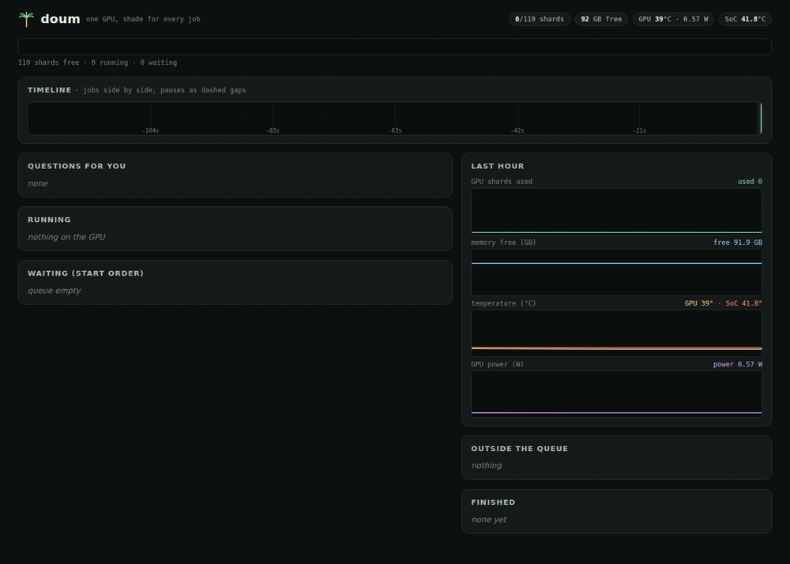
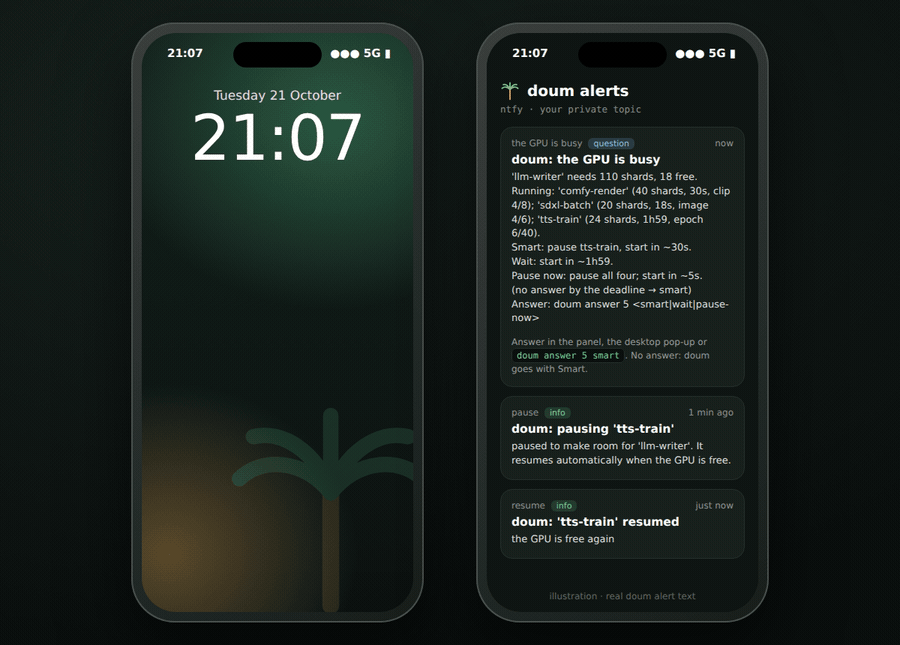

# Doum

**Your GPU has too many roommates. Doum makes them take turns.**

Local LLMs, ComfyUI image and video models, training runs and your AI coding sessions all want the same GPU. Doum is
the queue between them: every job asks for *shards* of GPU memory, waits its turn, and gets paused and resumed when
something more urgent needs the GPU. It talks to each app, and pings your phone when a decision is yours.


*Three jobs queued; an interactive 110-shard LLM job pauses the training run, waits for the render to finish and runs,
then the training resumes from its checkpoint. Recorded with stand-in CPU jobs ([recipe](docs/demo/)).*

> Named after the **doum palm** (دوم) of the Nile in Sudan: a tough, branching palm that survives the heat and gives
> shade to every traveller who stops under it. One GPU, shade for every job.

> **Status: v0.1.0.** Linux only. Built and tested on one machine: an NVIDIA DGX Spark (GB10,
> 128 GB unified memory). It should work on other NVIDIA Linux boxes, but nobody has tried yet. See
> [Status and roadmap](#status-and-roadmap).

## Why I built this

I run everything on one NVIDIA DGX Spark: local LLMs, ComfyUI image and video models, and text-to-speech model
training. Each one assumes it has the GPU to itself. So every switch meant closing one session, checking the GPU was
really empty, and only then starting the next.

When I got it wrong, something ran out of memory. Worse, the machine powered off without warning, three times; the
system logs traced each one to a model-load peak.

Doum is the tool I wanted instead of that routine. Every job waits its turn, long jobs step aside for urgent ones and
come back on their own, and my phone tells me when a decision is mine.

ComfyUI queues its own work and Ollama queues its own work, but nothing queues *across* them. Doum is that cross-app
queue: one binary with a daemon on `127.0.0.1:8420`, a CLI, a terminal UI, a web panel and an MCP server.

## What it does

- **One queue for every GPU app.** A job asks for shards of GPU memory (about 1 GB each; 110 shards by default). Doum
  starts a job only when its shards are free, so small jobs share the GPU and big ones get it alone.
- **Two lanes.** `--interactive` jobs (someone is waiting at the screen: a chat, a writer) always start before batch
  jobs. Inside a lane it is first come, first served, and nothing sneaks past the job at the front.
- **Four modes for a busy GPU.** `wait` (queue and pause nothing), `pause` (pause whatever is in the way), `smart`
  (let jobs that finish within 10 minutes complete, pause the longer ones) and `ask` (the default: a desktop pop-up
  with Smart / Wait / Pause now; no answer in 60 s means smart).
- **Pause means stop, requeue, resume.** A paused background job gets SIGTERM, has 90 s to save a checkpoint, and is
  started again automatically when the GPU is free, ahead of newer work. (This is not a freeze of GPU state; your job
  has to save and reload its own checkpoint. See [Pausable jobs](#pausable-jobs).)
- **Checks back.** If an interactive or foreground job has waited 20 minutes, Doum asks whether to pause what is in
  the way, keep waiting, or cancel.
- **Pre-start checks.** Before each job: wait for enough free memory (`MemAvailable`, which is the real GPU headroom
  on unified memory), ask an idle ComfyUI to unload its cached models if that memory is needed, and run your own
  `pre_start` hook (a thermal cool-down gate, for example).
- **Notices GPU work that bypasses it.** Processes that show up in `nvidia-smi` but belong to no Doum job are listed
  in `doum status` and alerted once.
- **Notifications.** Desktop pop-ups (with answer buttons for questions), ntfy phone push, and JSON webhooks.
- **Progress and ETAs.** Jobs report `doum progress "epoch 3/10" --eta 2h`; smart decisions and time estimates use it.
- **Energy per job.** GPU power from `nvidia-smi`, split between running jobs by shards.
- **Ways to watch it.** `doum status`, `doum top` (terminal UI with controls), `doum panel` (web panel with
  last-hour charts), and Prometheus metrics at `GET /metrics`.
- **Integrations.** A ComfyUI plugin (every prompt waits its turn), llama-swap (local models start on demand as Doum
  jobs), and Claude Code (MCP tools with agent limits, a PreToolUse hook, a skill).
- **Survives daemon restarts.** State is saved to disk after every change. Background jobs run in their own session
  and process group and keep running while the daemon restarts (also `systemctl --user restart doum`); the restarted
  daemon picks them up again.

## Install

Linux on x86_64 or aarch64. Release binaries are built on Ubuntu 22.04 (glibc 2.35).

```sh
curl -fsSL https://raw.githubusercontent.com/MoeEldouma/doum/main/install.sh | sh
```

This puts `doum` in `~/.local/bin`, checks the release's SHA-256, installs the systemd user service and starts it.
Options:

```sh
curl -fsSL https://raw.githubusercontent.com/MoeEldouma/doum/main/install.sh | DOUM_VERSION=v0.1.0 sh   # a specific release
curl -fsSL https://raw.githubusercontent.com/MoeEldouma/doum/main/install.sh | DOUM_NO_SERVICE=1 sh    # binary only
```

From source (any recent stable Rust):

```sh
git clone https://github.com/MoeEldouma/doum && cd doum
cargo build --release
install -m 0755 target/release/doum ~/.local/bin/doum
```

The systemd unit and the ComfyUI plugin expect the binary at `~/.local/bin/doum`.
[Getting started](docs/getting-started.md) covers the service, requirements and the first job.

## Quick start

Start the daemon (the installer already did this):

```sh
mkdir -p ~/.config/systemd/user && cp deploy/systemd/doum.service ~/.config/systemd/user/
systemctl --user daemon-reload && systemctl --user enable --now doum
# or, in a terminal: doum daemon
```

Run things through it:

```sh
doum status                                      # what is on the GPU, what is waiting, and why
doum run -s 16 -- python generate.py             # foreground: waits its turn, then runs here (never paused)
doum run -d -s 24 -n tts-train -- python train.py   # background (detached): logged, pausable; prints the job id
doum run -i -s 110 -n writer -- ./writer.sh      # interactive lane: starts before batch work
doum logs -f 2                                   # follow a background job's log
```

`-s/--shards` is how much GPU memory to reserve (default 8). `-d/--detach` runs the job in the background under the
daemon; only detached jobs can be paused. `-i/--interactive` puts the job in the interactive lane. `-m/--mode`
overrides the default mode for this job.

Inside a job, report progress so Doum can estimate and decide well:

```sh
doum progress "epoch 3/10" --eta 2h
```

### Quick look

With `default_mode = "smart"` (or `-m smart`), a render with 5 minutes left and a training run with 2 hours left, an
interactive job that needs the whole GPU pauses the training and waits for the render:

```console
$ doum run -d -s 60 -n comfy-render -- python render_queue.py     # reports progress "clip 2/5" --eta 5m
doum: job 1 'comfy-render' queued (60 shards)
1
$ doum run -d -s 24 -n tts-train -- python train.py               # reports progress "epoch 3/10" --eta 2h
doum: job 2 'tts-train' queued (24 shards)
2
$ doum run -i -m smart -s 110 -n writer -- ./writer.sh
doum: job 3 'writer' queued (110 shards)
doum: pausing job(s) [2] to make room
doum: expected start in ~5 min
doum: waiting for 110 shards (26 free)
...
doum: GPU ready, starting

$ doum status          # (from another terminal, while the writer waits)
GPU  [█████████████████████░░░░░░░░░░░░░░░░░░░]  60/110 shards used · 58 GB memory free

RUNNING
     1  comfy-render                  60 shards  batch          2 min  ~5 min left  clip 2/5

WAITING (in start order)
     3  writer                       110 shards  interactive waiting for 110 shards (50 free)
     2  tts-train                     24 shards  batch       waiting behind jobs ahead in the queue
```

When the writer has started, `tts-train` starts again on its own as soon as its 24 shards are free.

### Pausable jobs

Pausing is a stop and a restart, not a freeze. When Doum pauses a detached job it:

1. sends SIGTERM to the job's process group,
2. waits up to `pause_grace_s` (90 s by default), then sends SIGKILL,
3. puts the job back in the queue at its original place, and
4. later runs **the same command again** (same directory, same environment, same `DOUM_JOB_ID`).

So a pausable job must save a checkpoint when it gets SIGTERM (or at regular intervals) and pick up from that
checkpoint when it starts. A job that cannot do that should be run with `--no-pause`, or in the foreground (foreground
jobs are never paused). See [Getting started](docs/getting-started.md#writing-a-pausable-job) for an example.

## Watch it live



*The web panel (`doum panel`) during a busy few minutes, sped up 6x: a ComfyUI render, an SDXL batch, a training run and
an agent eval share the GPU; an interactive LLM job needs all 110 shards and asks what to do; Smart pauses the training
run, waits for the short jobs, runs the LLM, and the training resumes from its checkpoint. Recorded with stand-in CPU
jobs ([recipe](docs/demo/)).*

- **Shard bar:** one segment per running job, growing and shrinking as jobs start and end. A paused job's segment
  stripes while it saves its checkpoint; a dashed outline shows what the job at the front of the queue is waiting for.
- **Timeline:** every run of every job in the last 15 minutes on parallel tracks, so you see what shared the GPU and
  when. Pauses show as dashed gaps.
- **Questions for you:** when a job does not fit, the choices (Smart / Wait / Pause now) with Doum's time estimates
  and a countdown to the default.
- **Running and waiting:** progress messages and ETAs from `doum progress`, a progress bar per job, energy per job,
  and Pause / Cancel / Move up buttons.
- **Last hour:** shards used, free memory, GPU and SoC temperature, GPU power.

Prefer the terminal? `doum top` shows the same queue with keyboard controls.

## Alerts on your phone



Doum pushes to the free, open-source [ntfy](https://ntfy.sh) app (iOS and Android), so you know what your GPU is doing
when you are away from the desk:

| Alert | When | Priority |
|---|---|---|
| `doum: the GPU is busy` | a job does not fit and its mode is `ask`: the options, time estimates and the default | high |
| `doum: pausing '<job>'` | a job is paused to make room (it resumes on its own) | default |
| `doum: '<job>' resumed` | a paused job starts again | default |
| `doum: '<job>' finished` | a background (`-d`) job completes, with how long it ran | default |
| `doum: '<job>' failed` | a job exits non-zero (with the exit code and the `doum logs` command) | high |
| `doum: GPU used outside the queue` | a process uses the GPU without Doum (once per process) | high |

Setup takes two minutes: install the ntfy app, subscribe to a long random topic, and put its URL in
`~/.config/doum/doum.toml` as `[notify] ntfy_url`. The full guide, with privacy notes, self-hosting and
troubleshooting, is in [docs/phone-alerts.md](docs/phone-alerts.md). Webhooks (JSON) work the same way for Slack,
Discord or your own scripts.

## Integrations

| What | How | Docs |
|---|---|---|
| ComfyUI | `doum_gate` custom node: each prompt waits for a lease, the GPU is released when idle, pauses re-queue the interrupted prompt | [integrations.md](docs/integrations.md#comfyui) |
| llama-swap / Ollama / llama.cpp | each model server is started by llama-swap as `doum run -i ...`; it unloads after `ttl` and frees its shards | [integrations.md](docs/integrations.md#llama-swap) |
| Claude Code and other MCP clients | `doum mcp` (7 tools, agent limits), `doum claude-hook` PreToolUse hook, `gpu-share` skill | [integrations.md](docs/integrations.md#claude-code) |
| Prometheus / Grafana | `GET http://127.0.0.1:8420/metrics` | [integrations.md](docs/integrations.md#prometheus-and-grafana) |
| Phone / chat | ntfy topic, JSON webhooks | [integrations.md](docs/integrations.md#notifications) |

## Documentation

- [Getting started](docs/getting-started.md): install, the service, job lifecycle, modes, pausable jobs, commands
- [Configuration](docs/configuration.md): every key in `~/.config/doum/doum.toml`, environment variables
- [Integrations](docs/integrations.md): ComfyUI, llama-swap, Claude Code / MCP, Prometheus, notifications
- [Phone alerts](docs/phone-alerts.md): ntfy setup, what each alert means, privacy, troubleshooting
- [How it works](docs/how-it-works.md): scheduling rules, pre-start checks, restarts, security model, Slurm preview

## Design

```
 CLI · doum top · web panel · desktop/phone alerts · MCP (agents)
                    │
              doum daemon (127.0.0.1:8420): queue, smart decisions, ETAs, check-back, notifications
                    │
   ComfyUI (gate plugin) · llama-swap / Ollama / llama.cpp · training · scripts
                    │
          pre-start checks and hooks (free memory, your thermal gate)  →  GPU
```

The scheduling rules are pure functions with unit tests (`crates/doum/src/sched.rs`).

## Status and roadmap

v0.1.0 is the first release. It has been run day to day on one NVIDIA GB10 (128 GB unified memory) with ComfyUI,
llama-swap + Ollama and Claude Code. On that machine, gpt-oss-120b behind llama-swap loads and answers in 37 s and
generates 37 tok/s warm, and its memory is fully returned on unload. Other GPUs, discrete-memory cards and
multi-GPU machines are untested.

- [x] Native queue: shards, lanes, strict order, smart / wait / pause / ask, requeue + resume, check-back,
      unmanaged-process detection, notifications (desktop, ntfy, webhooks)
- [x] systemd user service, install script, release builds for x86_64 and aarch64
- [x] llama-swap integration: local LLMs started on demand as Doum jobs, unloaded when idle
- [x] `doum top` (terminal UI) and a web panel with history charts and energy per job
- [x] MCP server for AI agents (agent limits) + Claude Code skill and hook
- [x] ComfyUI gate plugin
- [x] Prometheus metrics (`GET /metrics`)
- [ ] Slurm backend: config files and an install script exist in `deploy/slurm`, but the CLI does not use Slurm yet
      (experimental preview)
- [ ] Answer Doum's questions from your phone (today: notify only; answer in the panel, pop-up or CLI)
- [ ] Real pause: freezing GPU state with `cuda-checkpoint` instead of stop + restart
- [ ] Packages, docs site, testing on more hardware

## License

Apache-2.0. Copyright Moe Eldouma.
