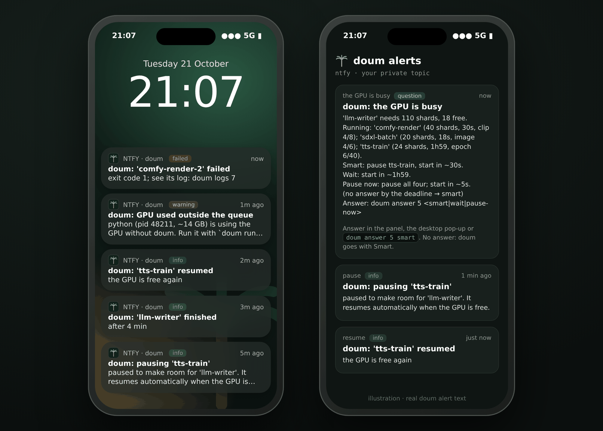

# Phone alerts

doum can push its alerts to your phone through [ntfy](https://ntfy.sh), a free and open-source push service with
apps for iOS and Android. You don't need an account, and you can run your own server.



*Illustration with doum's real alert text. Left: alerts arriving on the lock screen. Right: the ntfy app with a
question expanded.*

## How it gets there

```
 doum daemon (your machine)
      │  HTTPS POST: title, message, priority, tags
      ▼
 ntfy server (ntfy.sh or your own)
      │  push (Apple / Google push service)
      ▼
 ntfy app on your phone  →  lock screen, banner, sound
```

Alerts go out from your machine only. Nothing comes back from the phone to the daemon: the daemon listens on
localhost only (see [security](how-it-works.md#security-model)), so questions on the phone tell you how to answer at
the machine, and if nobody answers, doum applies its recommendation at the deadline.

## Setup (about two minutes)

1. **Install the ntfy app.** On iOS, get it from the App Store. On Android, use Google Play or F-Droid.

2. **Make a private topic name.** The topic works like a password: anyone who knows it can read your alerts. Make it
   long and random:

   ```sh
   echo "doum-$(openssl rand -hex 8)"      # e.g. doum-3f9c1a7e52b04d6e
   ```

3. **Subscribe in the app.** Tap **+**, enter the topic, and keep the server as `ntfy.sh`. Allow notifications when
   the phone asks.

   > **iPhone tip:** subscribe *inside the ntfy app*. If you open the topic URL (or scan a QR code) in Safari, you get
   > the ntfy web page, which only shows messages while it is open. Lock-screen alerts need the app.

4. **Tell doum.** In `~/.config/doum/doum.toml`:

   ```toml
   [notify]
   ntfy_url = "https://ntfy.sh/doum-3f9c1a7e52b04d6e"   # your topic
   ```

   Keep this file private. Don't commit it to a public dotfiles repo.

5. **Restart the daemon** so it reads the config: `systemctl --user restart doum`. Running jobs keep running.

6. **Send yourself a test.** A job that fails on purpose triggers a "failed" alert:

   ```sh
   doum run -d -s 1 -n phone-check -- sh -c 'exit 3'
   ```

   Within a few seconds your phone shows **doum: 'phone-check' failed**, with the text *exit code 3; see its log: doum
   logs N*.

## What each alert means

| Alert | Sent when | ntfy priority | What to do |
|---|---|---|---|
| **doum: the GPU is busy** | a job does not fit and its mode is `ask` (or the check-back after `max_wait_s`) | high | Nothing, if the recommendation is fine: it is applied at the deadline. Otherwise answer in the panel, the desktop pop-up or with `doum answer <id> <choice>` |
| **doum: pausing '&lt;job&gt;'** | doum stops a job to make room for a more urgent one | default | Nothing: it saves its checkpoint and resumes on its own |
| **doum: '&lt;job&gt;' resumed** | a paused job starts again | default | Nothing |
| **doum: '&lt;job&gt;' finished** | a background job completes (with how long it ran) | default | Pick up the results |
| **doum: '&lt;job&gt;' failed** | a job exits with a non-zero code, or could not start | high | Look at `doum logs <id>` |
| **doum: GPU used outside the queue** | a process uses the GPU without doum (once per process; the smallest are ignored, see `unmanaged_min_gb`) | high | Run it with `doum run` next time so it waits its turn |

`high` alerts make a sound and show as a banner. With `default`, the ntfy app's own settings apply, so you can mute
info alerts per topic in the app.

A question looks like this on the phone (the same text the panel shows):

```
doum: the GPU is busy
'llm-writer' needs 110 shards, 18 free. Running: 'comfy-render' (40 shards, 30s, clip 4/8); ...
Smart: pause tts-train, start in ~30s.
Wait: start in ~1h59.
Pause now: pause tts-train, comfy-render, sdxl-batch, agent-eval; start in ~5s.
(no answer by the deadline → smart)
Answer: doum answer 5 <smart|wait|pause-now>
```

## Privacy

- **The topic is the password.** On the public `ntfy.sh` server, anyone who knows your topic can read your alerts,
  which include job names and what is running. Use a long random topic and don't post screenshots that show it.
- **Running your own server:** ntfy is a single binary or a Docker image
  ([docs](https://docs.ntfy.sh/install/)). Point `ntfy_url` at it, for example `https://ntfy.example.com/doum`. doum
  does not send login credentials yet, so the server must accept anonymous publishing to that topic. Keep it private
  by making it reachable only over your VPN, for example Tailscale.
- **Turning it off:** set `ntfy_url = ""`.

## Troubleshooting

| Symptom | Likely cause |
|---|---|
| Nothing arrives at all | `ntfy_url` empty or misspelled; the daemon was not restarted after editing the config; check `journalctl --user -u doum` for `alert title=...` lines |
| Alerts show only while the app is open | You subscribed in the browser, not in the app (see the iPhone tip above), or notifications are off for ntfy in the phone's settings |
| No sound for pauses and resumes | Expected: they are `default` priority; raise it per topic in the app |
| Silent during Focus or Do Not Disturb | Allow ntfy in that Focus mode, or rely on `high` alerts breaking through if you allow time-sensitive notifications |
| Too many "outside the queue" alerts | Raise `unmanaged_min_gb`, or run those tools through `doum run` |

## Coming next

Answering questions from the phone, with action buttons that reach the daemon safely through a relay, is on the
roadmap. Until then the phone gets the alerts, and you answer at the machine (or let the deadline decide).

## Webhooks instead

For Slack, Discord, Home Assistant or your own scripts, add URLs to `webhooks`. Each alert is POSTed as JSON (see
[integrations](integrations.md#webhooks) for the payload).
